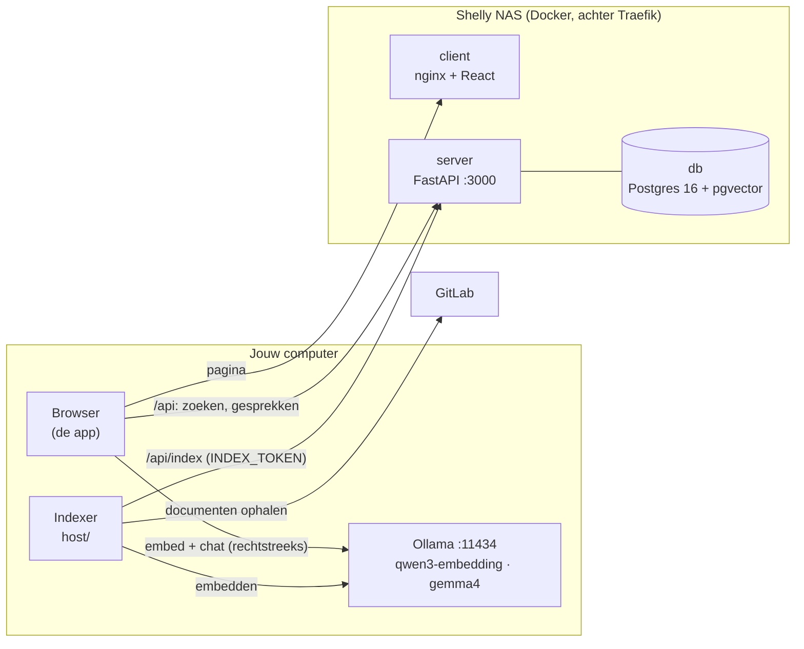

# shelly-chat

Een chatbot die vragen beantwoordt over je eigen documentatie (GitLab-wiki's en -repositories), met
bronvermelding. De app en de gegevens staan op de Shelly NAS. De taalmodellen draaien met
[Ollama](https://ollama.com) **op de computer waarop je de app opent**. Er gaat dus niets naar een
externe AI-dienst, en de NAS hoeft geen GPU te hebben.

- Productie: http://chat.shelly-nas.nl
- Acceptatie: http://chat-acc.shelly-nas.nl
- Lokaal: http://localhost:5173

## Architectuur



Waar wat gebeurt bij een vraag:

| Stap | Waar | Hoe |
|---|---|---|
| 1. Afkortingen uitschrijven (`VI` → `VI (Versleutelde Identiteit)`) | NAS | `POST /api/expand`, woordenboek uit de documenten |
| 2. Vraag omzetten naar een vector | jouw computer | browser → Ollama `/api/embed`, met het model van de index |
| 3. Zoeken en auto-mergen | NAS | `POST /api/retrieve`, cosine-zoekopdracht in pgvector. Komen genoeg kleine chunks van één sectie terug, dan krijgt het model de hele sectie |
| 4. Antwoord schrijven en streamen | jouw computer | browser → Ollama `/api/chat` |
| 5. Gesprek bewaren | NAS | `POST /api/conversations` |

De **NAS draait geen enkel model**: geen LLM, geen embeddings en geen reranker. Het image van de server
blijft daardoor klein (geen torch), en een NAS zonder GPU is genoeg. De **indexer** draait ook op een
computer met Ollama. Die kan meestal ook bij GitLab (VPN), en de GitLab-token blijft van de NAS af.

Ten opzichte van de vorige opzet (Qdrant + `docstore.json` + `abbreviations.json` + Next.js) is dit
veranderd:
- **Eén database:** chunks, embeddings, afkortingen en gesprekken staan in Postgres met pgvector. Een
  document wordt in één transactie vervangen, dus het lock-bestand is niet meer nodig.
- **Gesprekken worden bewaard** op de NAS en staan in de zijbalk.
- **Geen cross-encoder-reranking meer.** Dat zou een model op de NAS zetten. De volgorde komt nu uit de
  cosine-scores na het auto-mergen.

## Eenmalig per computer: Ollama klaarzetten

```bash
ollama pull qwen3-embedding:latest   # het embeddingmodel van de index
ollama pull gemma4:latest            # of een ander chatmodel, te kiezen in de app
```

Ollama beantwoordt alleen browserverzoeken van origins die het vertrouwt. Zet de NAS-adressen erbij
(`localhost` mag standaard al):

```bash
# macOS (daarna Ollama afsluiten en opnieuw openen)
launchctl setenv OLLAMA_ORIGINS "http://chat.shelly-nas.nl,http://chat-acc.shelly-nas.nl"

# Linux (systemd)
sudo systemctl edit ollama
#   [Service]
#   Environment="OLLAMA_ORIGINS=http://chat.shelly-nas.nl,http://chat-acc.shelly-nas.nl"
sudo systemctl restart ollama

# Windows (daarna Ollama afsluiten en opnieuw openen)
setx OLLAMA_ORIGINS "http://chat.shelly-nas.nl,http://chat-acc.shelly-nas.nl"
```

Chrome kan de eerste keer vragen of de pagina "apparaten in je lokale netwerk" mag gebruiken. Sta dat
toe: zo bereikt de pagina Ollama op je eigen computer. Draait Ollama op een andere machine in het
netwerk, vul dan het adres daarvan in onder **Instellingen**. Die machine moet dan met
`OLLAMA_HOST=0.0.0.0` luisteren.

## Lokaal draaien

```bash
cp .env.example .env    # vul DB_PASSWORD in
docker compose up --build
```

Open http://localhost:5173. Vul daarna de index met de indexer (zie [host/README.md](host/README.md)),
met `SHELLY_CHAT_URL=http://localhost:3000`.

Frontend ontwikkelen met hot reload, tegen de API uit compose:

```bash
cd client && npm install && npm run dev
```

Tests:

```bash
cd client && npm test
cd server && pip install -r requirements.txt && pytest   # API-tests met DB_HOST=… tegen een database met pgvector
cd host && pip install -r requirements.txt pytest && pytest
```

## Structuur

```
client/      React + Vite + MUI (huisstijl), praat met de NAS én met Ollama     → NAS
server/      FastAPI: zoeken, afkortingen, gesprekken, index-API; geen AI       → NAS
database/    Postgres 16 + pgvector, schema in init.sql                         → NAS
host/        indexer en evaluatie, draaien naast Ollama                         → jouw computer
```

## Configuratie op de NAS

| Variabele | Waar | Betekenis |
|---|---|---|
| `DB_USER`, `DB_NAME` | GitHub variable | database |
| `DB_PASSWORD` | GitHub secret | database |
| `INDEX_TOKEN` | GitHub secret | token van de indexer, verplicht op acc en prod (`openssl rand -hex 32`) |
| `LLM_MODEL_NAME` | GitHub variable (optioneel) | standaard chatmodel, standaard `gemma4:latest` |
| `LLM_SYSTEM_PROMPT` | GitHub variable (optioneel) | systeemprompt; `{today}` wordt de datum |
| `NO_ANSWER_RESPONSE` | GitHub variable (optioneel) | antwoord als er geen bronnen zijn |

Verder: `RETRIEVAL_TOP_K` (20), `CONTEXT_TOP_N` (5), `AUTOMERGE_THRESHOLD` (0.5), `LLM_TEMPERATURE`,
`LLM_TOP_P`, `LLM_TOP_K` en `LLM_NUM_CTX` hebben standaardwaarden in `server/app/config.py`.
Het embeddingmodel kies je niet op de NAS. Het volgt uit de index, dus uit `EMBED_MODEL` van de indexer.

## Deploy

Volgens de shelly-nas standaarden (`shelly-fundamentals`): elke PR naar `main` gaat naar acc, en het
mergen van de release-PR van release-please deployt productie. Eenmalig:

1. GitHub → *Settings → Secrets and variables → Actions*: variables `REGISTRY_URL`, `REGISTRY_USERNAME`,
   `DB_USER`, `DB_NAME` (en optioneel `LLM_MODEL_NAME`, `LLM_SYSTEM_PROMPT`, `NO_ANSWER_RESPONSE`);
   secrets `REGISTRY_PASSWORD`, `DB_PASSWORD` en `INDEX_TOKEN`.
2. *Settings → Actions → General*: "Allow GitHub Actions to create and approve pull requests" aanzetten.
3. Op de NAS: `mkdir -p /volume1/docker/shelly-chat/data/postgres && sudo chown -R 70:70 /volume1/docker/shelly-chat/data/postgres`.
4. Na de eerste deploy de index vullen vanaf je eigen computer, met `SHELLY_CHAT_URL=http://chat.shelly-nas.nl`
   en hetzelfde `INDEX_TOKEN` (zie [host/README.md](host/README.md)). De database op acc wordt bij elke
   deploy opnieuw opgebouwd, dus daar moet je na een deploy opnieuw indexeren.
