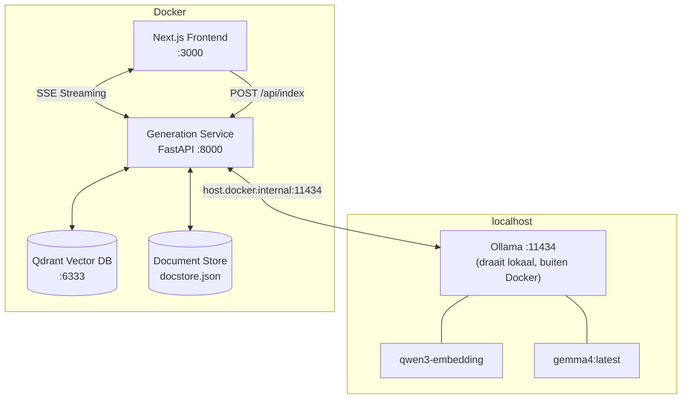
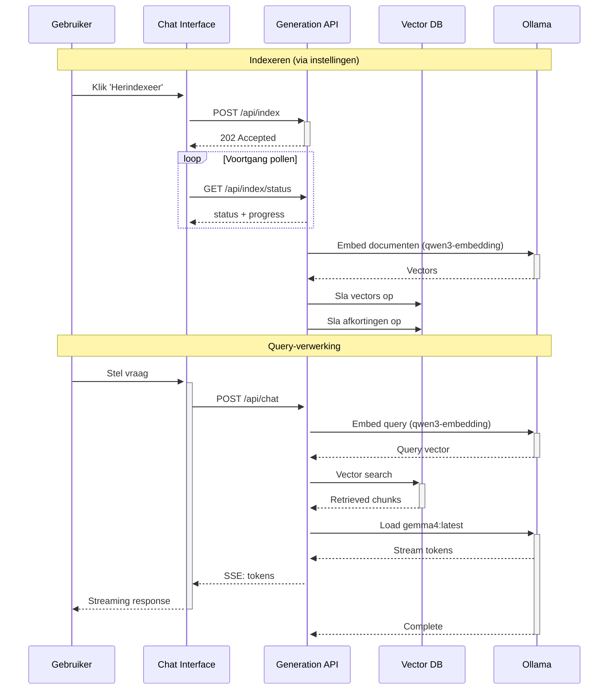

# RAG-Chat: Lokale Retrieval-Augmented Generation

Lokaal RAG-systeem voor het doorzoeken van lokale documenten met lokaal draaiende taalmodellen. Inclusief een Next.js webinterface, Python backend services en containerized deployment.

## Systeemarchitectuur

Het systeem bestaat uit twee onderdelen die op verschillende plekken draaien:

- **Ollama** draait rechtstreeks op de host (je eigen pc of laptop) — de modellen worden dus nooit naar een externe server gestuurd.
- **De rest van de applicatie** (frontend, backend, indexer en database) draait volledig in Docker-containers via `docker-compose`.



> **Let op:** de applicatie zelf is niet volledig lokaal — de frontend en backend draaien in Docker. Alleen Ollama (en daarmee de AI-modellen) draait direct op je machine.

## Projectstructuur

```
├── indexing/                   # Documentverwerking en embedding
├── generating/                 # RAG query-verwerking en generatie
├── vector-db/                  # Qdrant vector database
├── chat-app/                   # Next.js webinterface
├── tests/                      # Evaluatie en tests
├── docker-compose.yml          # Container orchestration
└── requirements.txt            # Python dependencies
```

## Snel aan de slag

### Vereisten

- [Ollama](https://ollama.com) geïnstalleerd en actief
- Docker & Docker Compose

### Installatie

1. **Installeer de benodigde modellen:**

```bash
ollama pull qwen3-embedding:latest
ollama pull gemma4:latest
```

2. **Configureer bronnen in `.env`** (`GITLAB_WIKI_URLS`, `GITLAB_REPO_URLS`, `GITLAB_PAT`)

3. **Start de services:**

```bash
docker compose up -d  # Start Qdrant + Generation API + Frontend
```

4. **Begin met chatten:** Ga naar `http://localhost:3000`

5. **Indexeer documenten** via het tandwiel-icoontje (⚙) in de chat-interface

### Servicestatus

- **Frontend**: `http://localhost:3000`
- **API**: `http://localhost:8000/docs`
- **Qdrant**: `http://localhost:6333/dashboard`
- **Ollama**: `http://localhost:11434`

## RAG Processing Pipeline



## Moduledocumentatie

| Module                       | Doel                       | Documentatie                   |
| ---------------------------- | -------------------------- | ------------------------------ |
| [`indexing/`](indexing/)     | PDF-verwerking & embedding | [README](indexing/README.md)   |
| [`generating/`](generating/) | RAG-verwerking & streaming | [README](generating/README.md) |
| [`vector-db/`](vector-db/)   | Qdrant vector storage      | [README](vector-db/README.md)  |
| [`chat-app/`](chat-app/)     | Next.js webinterface       | [README](chat-app/README.md)   |
| [`tests/`](tests/)           | Evaluatieframework         | [README](tests/README.md)      |

## Belangrijkste functies

- **Hierarchical Chunking** — Slim documenten opsplitsen met behoud van context (zie [`indexing/`](indexing/))
- **GitLab Integratie** — Wiki-pagina's en repository-bestanden indexeren via GitLab REST API
- **Source Citations** — Genummerde bronverwijzingen met similarity scores en directe GitLab-links
- **Streaming Responses** — Real-time SSE token-generatie
- **Hallucination Prevention** — Confidence gating en validatie
- **Indexeren via UI** — Herindexeer documenten vanuit de interface met voortgangsbalk; afkortingen worden automatisch meegeëxtraheerd
- **Moderne UI** — Next.js interface met inline bronweergave
- **Docker Deployment** — Containerized services met Compose

## Ontwikkeling

- **Indexeren**: Via de instellingen in de chat-interface (knop 'Herindexeer' of 'Volledig')
- **Frontend ontwikkeling**: `cd chat-app && npm run dev`
- **API testen**: `http://localhost:8000/docs`
- **Configuratie**: Zie de module READMEs voor environment variables
