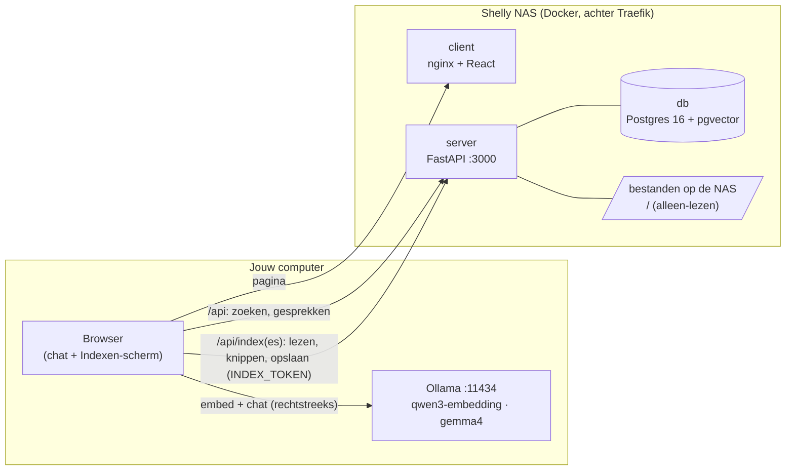

# shelly-chat

Een chatbot die vragen beantwoordt over je eigen documenten (Markdown, PDF, Word) op de NAS, met
bronvermelding. De app en de gegevens staan op de Shelly NAS. De taalmodellen draaien met
[Ollama](https://ollama.com) **op de computer waarop je de app opent**. Er gaat dus niets naar een
externe AI-dienst, en de NAS hoeft geen GPU te hebben.

- Productie: http://chat.shelly-nas.nl
- Acceptatie: http://chat-acc.shelly-nas.nl
- Lokaal: http://localhost:5173

## Architectuur



Waar wat gebeurt bij een vraag:

| Stap | Waar | Hoe |
|---|---|---|
| 1. Afkortingen uitschrijven (`VI` → `VI (Versleutelde Identiteit)`) | NAS | `POST /api/expand`, woordenboek uit de documenten |
| 2. Vraag omzetten naar een vector | jouw computer | browser → Ollama `/api/embed`, met het model van de index |
| 3. Zoeken en auto-mergen | NAS | `POST /api/retrieve`, cosine-zoekopdracht in pgvector. Komen genoeg kleine chunks van één sectie terug, dan krijgt het model de hele sectie |
| 4. Antwoord schrijven en streamen | jouw computer | browser → Ollama `/api/chat` |
| 5. Gesprek bewaren | NAS | `POST /api/conversations` |

De **NAS draait geen enkel model**: geen LLM, geen embeddings en geen reranker. Een NAS zonder GPU is
genoeg.

### Indexen

Je kunt meerdere **indexen** maken, elk met een eigen naam, bijvoorbeeld "Mijn BV" of "Handboek". Een
index heeft:
- **bronnen**: mappen of bestanden uit de documentenmap, die je toevoegt en verwijdert;
- **ignore-patronen**: regels zoals in een `.gitignore` (`archief/`, `*.tmp`, `!belangrijk.pdf`). Ze
  worden alleen op de NAS bewaard; er komt geen `.gitignore`-bestand in de documentenmap.

Bij een **nieuw gesprek** kies je bovenaan welke index het doorzoekt. Die keuze geldt voor alle vragen
in dat gesprek en ligt vast zodra het gesprek begonnen is.

Een index is handig, maar niet nodig. Kies je **Geen index**, is de index leeg, of lukt het zoeken niet
(bijvoorbeeld omdat het embeddingmodel ontbreekt of de NAS niet antwoordt), dan antwoordt het taalmodel
toch, zonder bronnen. Bij een mislukte zoekopdracht staat boven het antwoord waarom. Verwijder je een
index, dan gaan de gesprekken ervan zonder index verder.

Het embeddingmodel en de chunkgroottes gelden voor alle indexen samen. Een document dat in meerdere
indexen zit, wordt één keer geëmbed en opgeslagen.

**Indexeren** gaat via het scherm **Indexen** in de app, ook vanuit de browser:

| Stap | Waar |
|---|---|
| Documenten in de bronnen opsommen, ignore-patronen toepassen | NAS (`GET /api/indexes/{id}/files`) |
| Documenten lezen, tekst uit PDF/DOCX halen, hashen en in chunks knippen | NAS (`POST /api/index/prepare`) |
| De kleine chunks embedden | browser → Ollama op jouw computer |
| Opslaan, afkortingen eruit halen | NAS (`PUT /api/index/documents`) |
| Documenten die niet meer in de bronnen staan uit de index halen | NAS (`POST /api/indexes/{id}/prune`) |

Ongewijzigde documenten worden overgeslagen. Een ander embeddingmodel of andere chunkgroottes leegt
alle indexen en bouwt ze opnieuw op. Documenten die uit de bronnen verdwenen zijn (of nu genegeerd
worden), gaan uit de index, maar alleen als elke bron gelezen kon worden. Een map die (even) ontbreekt,
leegt de index dus nooit. Het index-token staat alleen in je browser, nooit op de NAS. Voor scripts of
een geplande taak doet de CLI in [host/](host/README.md) precies hetzelfde.

### Instellingen

Het scherm **Instellingen** heeft drie delen:

| Deel | Waar bewaard | Wat |
|---|---|---|
| **Deze browser** | localStorage | Ollama-adres, taalmodel, denken uitzetten, modellen ontladen, afkortingen uitschrijven, index-token |
| **Antwoorden** | NAS, voor iedereen | systeemprompt, antwoord zonder bronnen, temperatuur, top-p, top-k, contextvenster, maximale antwoordlengte, kandidaten, bronnen per vraag, merge-drempel, minimale relevantie, ook antwoorden zonder relevante bron, gespreksgeheugen, maximale vraaglengte |
| **Indexeren** | NAS, voor iedereen | embeddingmodel (uit de modellen in Ollama), grote en kleine chunks, overlap, maximale bestandsgrootte |

Wat op de NAS staat, geldt voor alle gesprekken, ook bestaande: elke vraag gebruikt de laatste waarde.
Wijzigen vraagt het `INDEX_TOKEN`. Alleen wat afwijkt van de standaard wordt bewaard; elk veld kan terug naar
de standaard. Een andere chunkgrootte bouwt bij de volgende indexering alle indexen opnieuw op. `{today}` in
de systeemprompt wordt de datum.

De standaard-systeemprompt laat het model antwoorden in twee delen: **Uit de documenten**, met een
bronverwijzing [nummer] bij elke bewering, en alleen als de bronnen tekortschieten **Buiten de bronnen**, duidelijk
gemarkeerd en zonder bronnummers. Haalt geen enkele bron de minimale relevantie, dan krijgt het model een lege
bronnenlijst en antwoordt het alleen buiten de bronnen. Zet "Ook antwoorden zonder relevante bron" uit om dan
direct het vaste antwoord zonder bronnen te geven.

"Denken uitzetten" stuurt `think: false` naar Ollama. Dat werkt voor elk model dat nadenkt (Qwen3, gpt-oss,
Gemma), in plaats van `/no_think` in de prompt, dat alleen Qwen3 kent.

### De documentenmap

Op acc en productie ziet de server **de hele NAS**: `/` wordt alleen-lezen in de server gemount, op
`/data/documents`. **Een bron is dus gewoon een absoluut pad op de NAS**, zoals
`/home/Jelle/Documents/Professioneel/JEX/Documenten` (een map, met alles erin) of
`/volume1/team/renovate.pdf` (één bestand). Bij de bronnen van een index kun je door de NAS bladeren.

Omdat de server alles kan lezen, gelden deze grenzen:
- Alleen ondersteunde documenten tellen mee (`.md`, `.adoc`, `.txt`, `.pdf`, `.docx`, `.doc`), en verborgen
  mappen (`.git`), Synology-mappen (`@eaDir`, `@docker`) en systeemmappen (`/proc`, `/sys`, `/dev`, `/run`,
  `/tmp`) worden overgeslagen.
- `/` zelf kan geen bron zijn; kies een map.
- Bladeren door de NAS vraagt het `INDEX_TOKEN`.
- **Openen** bij een bron in de chat (`GET /api/files/<pad>`) geeft alleen documenten die in een index
  zitten, nooit andere bestanden van de NAS.

Wil je de server toch tot één map beperken, zet dan de GitHub-variable `DOCUMENTS_DIR`, bijvoorbeeld
`/volume1/Documenten`. Bronnen zijn dan absolute paden binnen die map. Lokaal is het `./documents` in de
repo (staat in `.gitignore`), en zijn bronnen paden relatief aan die map.

Ten opzichte van de vorige opzet (Qdrant + `docstore.json` + `abbreviations.json` + Next.js) is dit
veranderd:
- **Eén database:** chunks, embeddings, afkortingen en gesprekken staan in Postgres met pgvector. Een
  document wordt in één transactie vervangen, dus het lock-bestand is niet meer nodig.
- **Gesprekken worden bewaard** op de NAS en staan in de zijbalk.
- **Knippen gebeurt op de NAS** (LlamaIndex' `HierarchicalNodeParser`, een tekstsplitter en geen model),
  zodat de app en de CLI dezelfde chunks maken.
- **Geen cross-encoder-reranking meer.** Dat zou een model op de NAS zetten. De volgorde komt nu uit de
  cosine-scores na het auto-mergen.

## Eenmalig per computer: Ollama klaarzetten

```bash
ollama pull qwen3-embedding:latest   # het embeddingmodel van de index
ollama pull gemma4:latest            # of een ander chatmodel, te kiezen in de app
```

Ollama beantwoordt alleen browserverzoeken van origins die het vertrouwt. Zet de NAS-adressen erbij
(`localhost` mag standaard al):

```bash
# macOS (daarna Ollama afsluiten en opnieuw openen)
launchctl setenv OLLAMA_ORIGINS "http://chat.shelly-nas.nl,http://chat-acc.shelly-nas.nl"

# Linux (systemd)
sudo systemctl edit ollama
#   [Service]
#   Environment="OLLAMA_ORIGINS=http://chat.shelly-nas.nl,http://chat-acc.shelly-nas.nl"
sudo systemctl restart ollama

# Windows (daarna Ollama afsluiten en opnieuw openen)
setx OLLAMA_ORIGINS "http://chat.shelly-nas.nl,http://chat-acc.shelly-nas.nl"
```

Chrome kan de eerste keer vragen of de pagina "apparaten in je lokale netwerk" mag gebruiken. Sta dat
toe: zo bereikt de pagina Ollama op je eigen computer. Draait Ollama op een andere machine in het
netwerk, vul dan het adres daarvan in onder **Instellingen**. Die machine moet dan met
`OLLAMA_HOST=0.0.0.0` luisteren.

## Lokaal draaien

```bash
cp .env.example .env    # vul DB_PASSWORD in
docker compose up --build
```

Zet een paar documenten in `./documents`, open http://localhost:5173 en ga naar **Indexen**. Lokaal is het index-token leeg, tenzij je `INDEX_TOKEN`
in `.env` zet; vul dan dezelfde waarde in.

Frontend ontwikkelen met hot reload, tegen de API uit compose:

```bash
cd client && npm install && npm run dev
```

Tests:

```bash
cd client && npm test
cd server && pip install -r requirements.txt && pytest   # API-tests met DB_HOST=… tegen een database met pgvector
cd host && pip install -r requirements.txt pytest && pytest
```

## Structuur

```
client/      React + Vite + MUI (huisstijl): chat en Indexen-scherm;
             praat met de NAS en met Ollama                                     → NAS
server/      FastAPI: zoeken, afkortingen, gesprekken, documenten lezen,
             knippen en opslaan; geen AI-modellen                               → NAS
database/    Postgres 16 + pgvector, schema in init.sql                         → NAS
host/        CLI-indexer en evaluatie, draaien naast Ollama                     → jouw computer
```

## Configuratie op de NAS

| Variabele | Waar | Betekenis |
|---|---|---|
| `DB_USER`, `DB_NAME` | GitHub variable | database |
| `DB_PASSWORD` | GitHub secret | database |
| `INDEX_TOKEN` | GitHub secret | token om de index en de bronnen te wijzigen, verplicht op acc en prod (`openssl rand -hex 32`) |
| `DOCUMENTS_DIR` | GitHub variable (optioneel) | map op de NAS die de server mag lezen, standaard `/` (de hele NAS) |
| `LLM_MODEL_NAME` | GitHub variable (optioneel) | standaard chatmodel, standaard `gemma4:latest` |
| `LLM_SYSTEM_PROMPT` | GitHub variable (optioneel) | standaard-systeemprompt; leeg is de Nederlandse prompt uit `server/app/config.py` |
| `NO_ANSWER_RESPONSE` | GitHub variable (optioneel) | standaardantwoord als er geen bronnen zijn |

Dit zijn alleen standaardwaarden: in de app pas je ze aan onder **Instellingen**. Dat geldt ook voor
`PARENT_CHUNK_SIZE` (1500), `CHILD_CHUNK_SIZE` (een kwart daarvan), `PARENT_CHUNK_OVERLAP` (300),
`MAX_FILE_MB` (50), `RETRIEVAL_TOP_K` (50), `CONTEXT_TOP_N` (10), `AUTOMERGE_THRESHOLD` (0.5),
`MIN_SIMILARITY` (0.5),
`QUERY_MAX_LENGTH` (4000), `CHAT_HISTORY_MAX_TURNS` (10), `LLM_TEMPERATURE` (1.0), `LLM_TOP_P` (0.95),
`LLM_TOP_K` (64), `LLM_NUM_CTX` (32000) en `LLM_MAX_TOKENS` (32000), met hun standaard in
`server/app/config.py`.
Het embeddingmodel kies je onder **Instellingen → Indexeren** (standaard `EMBED_MODEL`, `qwen3-embedding:latest`);
de app en de CLI indexeren daarmee, en vragen gebruiken automatisch het model waarmee de index gebouwd is.

## Deploy

Volgens de shelly-nas standaarden (`shelly-fundamentals`): elke PR naar `main` gaat naar acc, en het
mergen van de release-PR van release-please deployt productie. Eenmalig:

1. GitHub → *Settings → Secrets and variables → Actions*: variables `REGISTRY_URL`, `REGISTRY_USERNAME`,
   `DB_USER`, `DB_NAME` (en optioneel `DOCUMENTS_DIR`, `LLM_MODEL_NAME`, `LLM_SYSTEM_PROMPT`, `NO_ANSWER_RESPONSE`);
   secrets `REGISTRY_PASSWORD`, `DB_PASSWORD` en `INDEX_TOKEN`.
2. *Settings → Actions → General*: "Allow GitHub Actions to create and approve pull requests" aanzetten.
3. Op de NAS: `mkdir -p /volume1/docker/shelly-chat/data/postgres && sudo chown -R 70:70 /volume1/docker/shelly-chat/data/postgres`,
   en `mkdir -p /volume1/docker/shelly-chat/documents` voor de demodata op acc.
4. Na de eerste deploy: open **Indexen**, vul het `INDEX_TOKEN` in, maak een index, voeg de bronnen
   toe en klik op **Index bijwerken**. De database op acc wordt bij elke deploy opnieuw opgebouwd. Op
   acc staat daarom al een index "Alle documenten" klaar met `/volume1/docker/shelly-chat/documents` als bron (demodata);
   je hoeft daar alleen op **Alle indexen bijwerken** te klikken.
