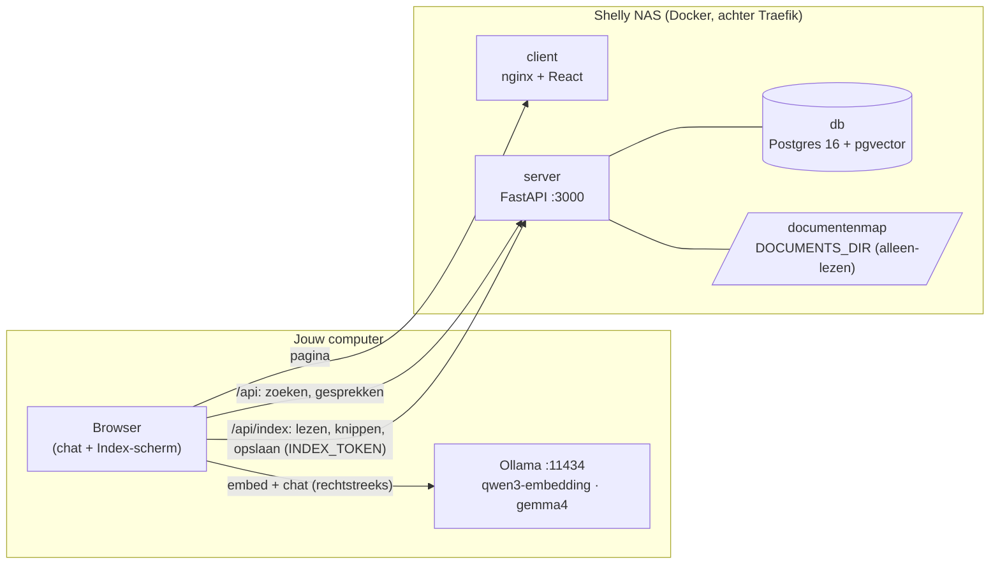

# shelly-chat

Een chatbot die vragen beantwoordt over je eigen documenten (Markdown, PDF, Word) op de NAS, met
bronvermelding. De app en de gegevens staan op de Shelly NAS. De taalmodellen draaien met
[Ollama](https://ollama.com) **op de computer waarop je de app opent**. Er gaat dus niets naar een
externe AI-dienst, en de NAS hoeft geen GPU te hebben.

- Productie: http://chat.shelly-nas.nl
- Acceptatie: http://chat-acc.shelly-nas.nl
- Lokaal: http://localhost:5173

## Architectuur



Waar wat gebeurt bij een vraag:

| Stap | Waar | Hoe |
|---|---|---|
| 1. Afkortingen uitschrijven (`VI` → `VI (Versleutelde Identiteit)`) | NAS | `POST /api/expand`, woordenboek uit de documenten |
| 2. Vraag omzetten naar een vector | jouw computer | browser → Ollama `/api/embed`, met het model van de index |
| 3. Zoeken en auto-mergen | NAS | `POST /api/retrieve`, cosine-zoekopdracht in pgvector. Komen genoeg kleine chunks van één sectie terug, dan krijgt het model de hele sectie |
| 4. Antwoord schrijven en streamen | jouw computer | browser → Ollama `/api/chat` |
| 5. Gesprek bewaren | NAS | `POST /api/conversations` |

De **NAS draait geen enkel model**: geen LLM, geen embeddings en geen reranker. Een NAS zonder GPU is
genoeg.

**Indexeren** gaat via het scherm **Index** in de app, ook vanuit de browser:

| Stap | Waar |
|---|---|
| Bronnen beheren: mappen of bestanden in de documentenmap | NAS, gedeeld voor iedereen |
| Documenten lezen, tekst uit PDF/DOCX halen, hashen en in chunks knippen | NAS (`POST /api/index/prepare`) |
| De kleine chunks embedden | browser → Ollama op jouw computer |
| Opslaan, afkortingen eruit halen | NAS (`PUT /api/index/documents`) |

Ongewijzigde documenten worden overgeslagen. Een ander embeddingmodel of andere chunkgroottes leegt de
index en bouwt hem opnieuw op. Documenten die uit de bronnen verdwenen zijn, worden verwijderd, maar
alleen als elke bron gelezen kon worden. Een map die (even) ontbreekt, leegt de index dus nooit. Het
index-token staat alleen in je browser, nooit op de NAS. Voor scripts of een geplande taak doet de CLI in
[host/](host/README.md) precies hetzelfde.

### De documentenmap

De documenten staan in één map op de NAS, `DOCUMENTS_DIR` (standaard
`/volume1/docker/shelly-chat/documents`). Die map wordt alleen-lezen in de server gemount, op
`/data/documents`. **Een bron is een pad relatief aan die map**: `handboek` is
`<DOCUMENTS_DIR>/handboek` met alles erin, `team/renovate.pdf` is één bestand, en leeg is de hele map.
Een absoluut pad werkt niet. De server ziet alleen wat in de documentenmap staat, en weigert paden met
`..` of symlinks die eruit wijzen. Het Index-scherm toont de map en laat je erdoorheen bladeren. Bij een
bron in de chat opent **Openen** het originele document via `GET /api/files/<pad>`.

Acc en productie lezen dezelfde map. Een andere map, bijvoorbeeld een gedeelde map als
`/volume1/Documenten`, stel je in met de GitHub-variable `DOCUMENTS_DIR`. Lokaal is het `./documents`
in de repo (staat in `.gitignore`).

Ten opzichte van de vorige opzet (Qdrant + `docstore.json` + `abbreviations.json` + Next.js) is dit
veranderd:
- **Eén database:** chunks, embeddings, afkortingen en gesprekken staan in Postgres met pgvector. Een
  document wordt in één transactie vervangen, dus het lock-bestand is niet meer nodig.
- **Gesprekken worden bewaard** op de NAS en staan in de zijbalk.
- **Knippen gebeurt op de NAS** (LlamaIndex' `HierarchicalNodeParser`, een tekstsplitter en geen model),
  zodat de app en de CLI dezelfde chunks maken.
- **Geen cross-encoder-reranking meer.** Dat zou een model op de NAS zetten. De volgorde komt nu uit de
  cosine-scores na het auto-mergen.

## Eenmalig per computer: Ollama klaarzetten

```bash
ollama pull qwen3-embedding:latest   # het embeddingmodel van de index
ollama pull gemma4:latest            # of een ander chatmodel, te kiezen in de app
```

Ollama beantwoordt alleen browserverzoeken van origins die het vertrouwt. Zet de NAS-adressen erbij
(`localhost` mag standaard al):

```bash
# macOS (daarna Ollama afsluiten en opnieuw openen)
launchctl setenv OLLAMA_ORIGINS "http://chat.shelly-nas.nl,http://chat-acc.shelly-nas.nl"

# Linux (systemd)
sudo systemctl edit ollama
#   [Service]
#   Environment="OLLAMA_ORIGINS=http://chat.shelly-nas.nl,http://chat-acc.shelly-nas.nl"
sudo systemctl restart ollama

# Windows (daarna Ollama afsluiten en opnieuw openen)
setx OLLAMA_ORIGINS "http://chat.shelly-nas.nl,http://chat-acc.shelly-nas.nl"
```

Chrome kan de eerste keer vragen of de pagina "apparaten in je lokale netwerk" mag gebruiken. Sta dat
toe: zo bereikt de pagina Ollama op je eigen computer. Draait Ollama op een andere machine in het
netwerk, vul dan het adres daarvan in onder **Instellingen**. Die machine moet dan met
`OLLAMA_HOST=0.0.0.0` luisteren.

## Lokaal draaien

```bash
cp .env.example .env    # vul DB_PASSWORD in
docker compose up --build
```

Zet een paar documenten in `./documents`, open http://localhost:5173 en ga naar **Index**. Lokaal is het index-token leeg, tenzij je `INDEX_TOKEN`
in `.env` zet; vul dan dezelfde waarde in.

Frontend ontwikkelen met hot reload, tegen de API uit compose:

```bash
cd client && npm install && npm run dev
```

Tests:

```bash
cd client && npm test
cd server && pip install -r requirements.txt && pytest   # API-tests met DB_HOST=… tegen een database met pgvector
cd host && pip install -r requirements.txt pytest && pytest
```

## Structuur

```
client/      React + Vite + MUI (huisstijl): chat en Index-scherm;
             praat met de NAS en met Ollama                                     → NAS
server/      FastAPI: zoeken, afkortingen, gesprekken, documenten lezen,
             knippen en opslaan; geen AI-modellen                               → NAS
database/    Postgres 16 + pgvector, schema in init.sql                         → NAS
host/        CLI-indexer en evaluatie, draaien naast Ollama                     → jouw computer
```

## Configuratie op de NAS

| Variabele | Waar | Betekenis |
|---|---|---|
| `DB_USER`, `DB_NAME` | GitHub variable | database |
| `DB_PASSWORD` | GitHub secret | database |
| `INDEX_TOKEN` | GitHub secret | token om de index en de bronnen te wijzigen, verplicht op acc en prod (`openssl rand -hex 32`) |
| `DOCUMENTS_DIR` | GitHub variable (optioneel) | documentenmap op de NAS, standaard `/volume1/docker/shelly-chat/documents` |
| `LLM_MODEL_NAME` | GitHub variable (optioneel) | standaard chatmodel, standaard `gemma4:latest` |
| `LLM_SYSTEM_PROMPT` | GitHub variable (optioneel) | systeemprompt; `{today}` wordt de datum |
| `NO_ANSWER_RESPONSE` | GitHub variable (optioneel) | antwoord als er geen bronnen zijn |

Verder: `PARENT_CHUNK_SIZE` (1500), `CHILD_CHUNK_SIZE` (een kwart daarvan), `PARENT_CHUNK_OVERLAP` (300),
`RETRIEVAL_TOP_K` (20), `CONTEXT_TOP_N` (5), `AUTOMERGE_THRESHOLD` (0.5), `LLM_TEMPERATURE`,
`LLM_TOP_P`, `LLM_TOP_K` en `LLM_NUM_CTX` hebben standaardwaarden in `server/app/config.py`.
Het embeddingmodel kies je niet op de NAS, maar bij het indexeren. Vragen gebruiken daarna automatisch hetzelfde model.

## Deploy

Volgens de shelly-nas standaarden (`shelly-fundamentals`): elke PR naar `main` gaat naar acc, en het
mergen van de release-PR van release-please deployt productie. Eenmalig:

1. GitHub → *Settings → Secrets and variables → Actions*: variables `REGISTRY_URL`, `REGISTRY_USERNAME`,
   `DB_USER`, `DB_NAME` (en optioneel `DOCUMENTS_DIR`, `LLM_MODEL_NAME`, `LLM_SYSTEM_PROMPT`, `NO_ANSWER_RESPONSE`);
   secrets `REGISTRY_PASSWORD`, `DB_PASSWORD` en `INDEX_TOKEN`.
2. *Settings → Actions → General*: "Allow GitHub Actions to create and approve pull requests" aanzetten.
3. Op de NAS: `mkdir -p /volume1/docker/shelly-chat/data/postgres && sudo chown -R 70:70 /volume1/docker/shelly-chat/data/postgres`,
   en `mkdir -p /volume1/docker/shelly-chat/documents` (of de map uit `DOCUMENTS_DIR`). Zet daar de documenten in.
4. Na de eerste deploy: open **Index**, vul het `INDEX_TOKEN` in, voeg de bronnen toe en klik op
   **Indexeren**. De database op acc wordt bij elke deploy opnieuw opgebouwd. Op acc staat de hele
   documentenmap daarom al als bron klaar (demodata); je hoeft daar alleen opnieuw te indexeren.
