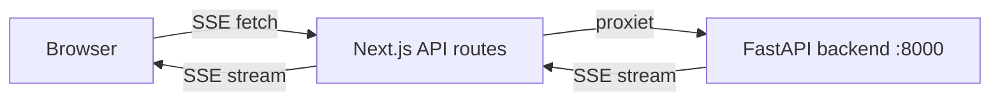

# Chat Interface (Next.js)

Next.js frontend voor de RAG-chatbot. Proxiet SSE-streams van de FastAPI backend en rendert gestreamde responses met bronverwijzingen.

Zie [`generating/README.md`](../generating/README.md) voor de backend API.

## Inhoud van de Map

```
chat-app/
├── README.md
├── package.json
├── next.config.ts
├── tsconfig.json
├── tailwind.config.js
├── components.json           # shadcn/ui configuratie
├── public/                   # Statische assets
└── src/
    ├── app/
    │   ├── layout.tsx        # Root layout met ThemeProvider
    │   ├── page.tsx          # Hoofd-chatpagina
    │   ├── globals.css
    │   └── api/              # Next.js API routes (proxy naar backend)
    │       ├── chat/         # POST — proxiet SSE-stream
    │       ├── health/       # GET  — proxiet /status van backend
    │       ├── reset/        # POST — reset chatgeschiedenis
    │       ├── index/        # POST — start indexeerrun
    │       ├── index/status/ # GET  — indexeerstatus en voortgang
    │       └── open-pdf/     # GET  — bestandsinformatie voor frontend
    └── components/
        ├── ui/               # shadcn/ui basiscomponenten
        ├── FormattedMessage.tsx     # Markdown-rendering van LLM-antwoorden
        ├── QueryExpansionBadge.tsx  # Badge per toegepaste afkorting
        ├── QueryExpansionBubble.tsx # Samengevouwen bubel boven het antwoord
        ├── SettingsPanel.tsx        # Instellingen, servicestatus en indexeerknoppen
        └── SourcePanel.tsx          # Bronweergave met similarity scores
```

## Architectuur

De Next.js API routes fungeren als proxy tussen de browser en de FastAPI backend. De browser communiceert nooit rechtstreeks met de backend — alle requests lopen via Next.js.



De `BACKEND_URL` omgevingsvariabele bepaalt waar de proxy naartoe stuurt (standaard `http://localhost:8000`; in Docker `http://generating:8000`).

## Functionaliteit

### Chatinterface

- Gestreamde responses via SSE — tokens verschijnen real-time
- Chatgeschiedenis wordt bijgehouden per sessie (`session_id: 'default'`)
- Nieuwe chat reset de sessie via `POST /api/reset`
- Annuleren van een lopend verzoek via `AbortController`
- Auto-scroll naar het laatste bericht

### Bronweergave

- Contextfragmenten verschijnen zodra het `contexts` SSE-event binnenkomt
- Elk fragment toont bestandspad, paginanummer, similarity score en `chunk_type` (parent/child)
- Bij GitLab-bronnen opent een knop de originele wiki-pagina of het repository-bestand
- Op mobiel openen bronnen in een modaal

### Query expansion

- Afkortingen in de query worden uitgebreid via `abbreviations.json`
- Per bericht toont een `QueryExpansionBubble` welke afkortingen zijn toegepast
- Instelbaar per gebruiker via de schakelaar in het instellingenpaneel; voorkeur wordt opgeslagen in `localStorage`

### Instellingenpaneel (`SettingsPanel`)

- Servicestatus van backend, Qdrant en Ollama (gepollt via `/api/health`)
- Drie indexeerknoppen: **Herindexeer**, **Volledig**, **Afkortingen**
- Voortgangsbalk tijdens indexering (gepollt via `/api/index/status` elke 2s)
- Themawissel: licht / donker / systeem

## Configuratie

| Variabele      | Standaard               | Beschrijving                                          |
| -------------- | ----------------------- | ----------------------------------------------------- |
| `BACKEND_URL`  | `http://localhost:8000` | URL van de FastAPI backend (server-side, niet publiek) |

## Ontwikkeling

```bash
cd chat-app
npm install
npm run dev    # http://localhost:3000
npm run build
npm run lint
```

## Docker Deployment

```bash
docker compose up -d
```

De container gebruikt `BACKEND_URL=http://generating:8000` om de backend binnen het Docker-netwerk te bereiken.
