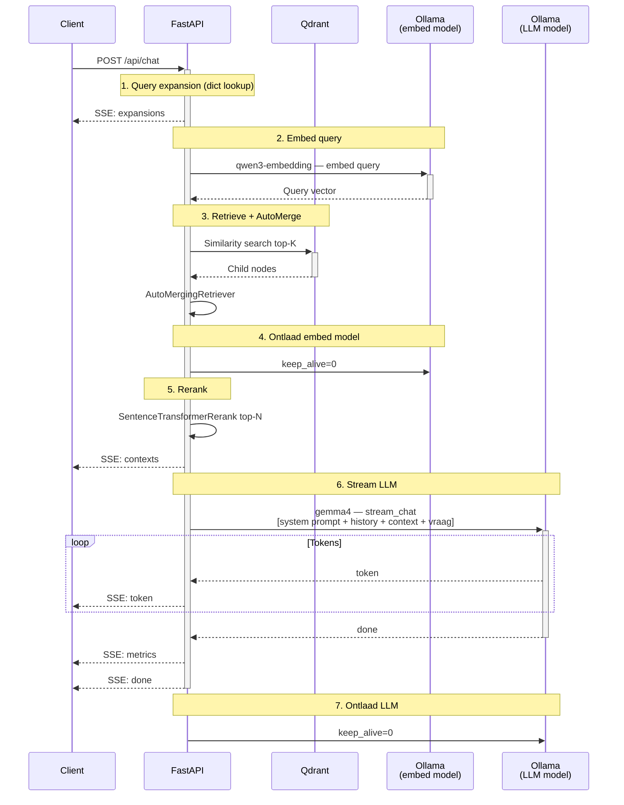

# Text Generation Service

FastAPI backend voor RAG query-verwerking: retrieval, context assembly en streaming LLM-responses.

Zie [`indexing/README.md`](../indexing/README.md) voor de retrieval-strategie en [`vector-db/README.md`](../vector-db/README.md) voor opslagconfiguratie.

## Inhoud van de Map

```
generating/
├── README.md              # Dit bestand
├── __init__.py            # Python package
├── app.py                 # FastAPI applicatie en API-endpoints
├── generator.py           # LLM-integratie via LlamaIndex Ollama
├── indexing_runner.py     # Achtergrond-indexeerthread
├── query_expander.py      # Afkortingsuitbreiding via woordenboek
└── Dockerfile             # Containerconfig voor deployment
```

## Request Flow



## API Endpoints

| Endpoint | Methode | Beschrijving |
|----------|---------|-------------|
| `/api/chat` | POST | Conversationele RAG-query, gestreamd via SSE |
| `/api/index` | POST | Start achtergrond-indexeerrun (202 Accepted) |
| `/api/index/status` | GET | Huidige indexeerstatus en voortgang |
| `/api/reset` | POST | Verwijder chatgeschiedenis van een sessie |
| `/api/models/status` | GET | Overzicht van geladen Ollama-modellen |
| `/api/models/unload` | POST | Ontlaad een specifiek model |
| `/api/models/cleanup` | POST | Ontlaad alle geladen modellen |
| `/api/open-file` | GET | Bestandsinformatie voor de frontend |
| `/health` | GET | Liveness check |
| `/status` | GET | Statuscheck van alle services (Qdrant, Ollama) |

### SSE-events van `/api/chat`

```
event: expansions   — toegepaste afkortingsuitbreidingen
event: contexts     — opgehaalde documentfragmenten met metadata
event: token        — individuele LLM-tokens
event: metrics      — doorlooptijd en modelnaam
event: done         — stream voltooid
event: error        — bij een fout
```

### `/api/index` request body

```json
{"full_reindex": false, "build_abbreviations": false}
```

### `/api/index/status` response

```json
{
  "status": "running",
  "message": "Embedden en upserten van 12 document(en) ...",
  "progress_current": 4,
  "progress_total": 12,
  "started_at": "2026-05-12T10:00:00Z",
  "finished_at": null
}
```

Status: `idle` | `running` | `done` | `error`

## Configuratie

| Variabele                | Standaard                               | Beschrijving                                               |
| ------------------------ | --------------------------------------- | ---------------------------------------------------------- |
| `LLM_MODEL_NAME`         | `gemma4:latest`                         | Ollama model voor tekstgeneratie                           |
| `LLM_MAX_TOKENS`         | `32000`                                 | Maximale responslengte                                     |
| `LLM_TEMPERATURE`        | `1.0`                                   | Willekeurigheid van generatie                              |
| `LLM_TOP_P`              | `0.95`                                  | Top-p nucleus sampling                                     |
| `LLM_TOP_K`              | `64`                                    | Top-k sampling                                             |
| `RETRIEVAL_TOP_K`        | `20`                                    | Aantal child nodes uit Qdrant                              |
| `RERANKER_TOP_N`         | `5`                                     | Aantal nodes naar LLM na reranking                         |
| `RERANKER_MODEL_NAME`    | `cross-encoder/ms-marco-MiniLM-L-6-v2` | SentenceTransformer reranker model                         |
| `AUTOMERGE_THRESHOLD`    | `0.5`                                   | Minimale siblings-verhouding om te mergen naar parent node |
| `LLM_SYSTEM_PROMPT`      | *(ingebouwd)*                           | System prompt voor het LLM; overschrijft de standaard prompt |
| `NO_ANSWER_RESPONSE`     | *(Nederlands)*                          | Fallback als retrieval geen resultaten geeft               |
| `CHAT_HISTORY_MAX_TURNS` | `10`                                    | Aantal vorige beurten per LLM-aanroep                      |
| `QUERY_MAX_LENGTH`       | `2000`                                  | Maximale querylengte in tekens                             |
| `VERBOSE`                | `0`                                     | Zet op `1` voor gedetailleerde retrieval logging           |

## Belangrijkste functies

### Query expansion

Afkortingen in de query worden automatisch uitgebreid via `vector-db/abbreviations.json`, opgebouwd tijdens het indexeren. Instelbaar per gebruiker via de frontend.

```
"Wat is een BSN?"  →  "Wat is een BSN (Burgerservicenummer)?"
```

### No-answer handling

1. **Lege retrieval** — als Qdrant geen resultaten geeft, wordt de fallback-tekst gestreamd zonder het LLM aan te roepen.
2. **Onvoldoende context** — de system prompt instrueert het LLM om alleen binnen de gevonden context te antwoorden.

### Chatgeschiedenis

Per sessie bewaart de service de volledige gespreksgeschiedenis in memory. Per LLM-aanroep worden alleen de laatste `CHAT_HISTORY_MAX_TURNS` beurten meegestuurd om het contextvenster beheersbaar te houden:

```
[system prompt] + [laatste CHAT_HISTORY_MAX_TURNS beurten] + [huidige vraag + opgehaalde context]
```

Één beurt = één gebruikersbericht + één assistent-antwoord. Met de standaard van 10 beurten worden er maximaal 20 berichten uit de geschiedenis meegestuurd. De volledige geschiedenis blijft in memory bewaard voor de levensduur van de sessie — alleen wat naar het LLM gaat is gemaximeerd.

Sessies worden automatisch verwijderd als het maximum van 100 gelijktijdige sessies bereikt wordt (oudste sessie wordt verwijderd). Een sessie handmatig verwijderen kan via `POST /api/reset`.

### Sequentieel model laden

Na het embedden wordt het embed model ontladen (`keep_alive=0`) voordat het LLM wordt geladen. Na het genereren wordt ook het LLM ontladen. Dit voorkomt dat beide modellen tegelijk in VRAM staan.

### Retrieval state reload

Na een indexeerrun herlaadt de service automatisch de docstore en herbouwt de `VectorStoreIndex`, zodat nieuwe documenten direct doorzoekbaar zijn zonder herstart.

## Docker Deployment

```bash
docker compose up -d generating
docker compose logs -f generating
curl http://localhost:8000/health
```
