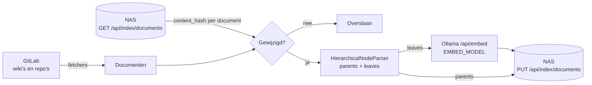

# host/: tools naast Ollama

Wat hier staat draait **niet op de NAS**, maar op een computer met Ollama (en, als GitLab achter een VPN
zit, met de VPN aan):

| Onderdeel | Doel |
|---|---|
| `indexing/` | Haalt documenten uit GitLab, knipt ze in chunks, embedt die met Ollama en slaat ze op de NAS op |
| `rag.py` | Dezelfde vraag-en-antwoordpijplijn als de browser, voor de terminal en de evaluatie |
| `tests/unit/` | Unittests van de indexer (draaien in CI) |
| `tests/eval/` | RAGAS-evaluatie van de antwoordkwaliteit (handmatig, traag) |
| `docs/` | Ollama installeren op Rocky Linux (Sapphire Rapids) |

## Installeren

Python 3.12:

```bash
cd host
python -m venv .venv && source .venv/bin/activate
pip install -r requirements.txt
cp .env.example .env    # vul SHELLY_CHAT_URL, INDEX_TOKEN, GITLAB_* in
ollama pull qwen3-embedding:latest
```

## Indexeren

```bash
python -m indexing.indexer                        # incrementeel: alleen nieuw en gewijzigd
python -m indexing.indexer --full-reindex         # index op de NAS leegmaken en alles opnieuw
python -m indexing.indexer --build-abbreviations  # alleen de afkortingen opnieuw opbouwen
```

Zo gaat een run:



1. Alle bronnen uit `GITLAB_WIKI_URLS` en `GITLAB_REPO_URLS` worden eerst opgehaald, zodat het
   embeddingmodel maar één keer laadt.
2. De NAS geeft per document de `content_hash` van wat er al staat. Ongewijzigde documenten worden
   overgeslagen. Documenten die niet meer in GitLab staan, worden van de NAS verwijderd.
3. Elk nieuw of gewijzigd document wordt opgedeeld in parents (`PARENT_CHUNK_SIZE` tokens) en
   leaves (`PARENT_CHUNK_SIZE // 4`). Alleen de leaves worden geëmbed. De NAS vervangt het document in
   één transactie en haalt er meteen de afkortingen uit (`ABC (Volledige Term)` en `Volledige Term (ABC)`).
4. Daarna ontlaadt de indexer het embeddingmodel (`keep_alive: 0`).

**Configuratiewijziging:** de NAS onthoudt met welk `EMBED_MODEL`, welke dimensie en welke chunkgroottes
de index gebouwd is. Wijkt de indexer daarvan af, dan leegt hij de index en begint hij opnieuw. Vectoren
van verschillende modellen zijn niet te vergelijken. Wie in de app een vraag stelt, gebruikt automatisch
het embeddingmodel van de index. Dat model moet dus ook op die computer staan.

Een onderbroken run is veilig: wat al opgeslagen is, blijft staan, en de volgende run gaat verder met de rest.

## Configuratie (`host/.env`)

| Variabele | Standaard | Betekenis |
|---|---|---|
| `SHELLY_CHAT_URL` | `http://localhost:3000` | De shelly-chat-server; prod `http://chat.shelly-nas.nl`, acc `http://chat-acc.shelly-nas.nl` |
| `INDEX_TOKEN` | leeg | Gelijk aan `INDEX_TOKEN` op de NAS |
| `OLLAMA_BASE_URL` | `http://localhost:11434` | Ollama op deze computer |
| `EMBED_MODEL` | `qwen3-embedding:latest` | Embeddingmodel; bepaalt ook welk model de app voor vragen gebruikt |
| `EMBED_BATCH_SIZE` | `16` | Chunks per embed-aanroep |
| `PARENT_CHUNK_SIZE` | `1500` | Tokens per parent-chunk |
| `CHILD_CHUNK_SIZE` | `PARENT // 4` | Tokens per leaf; afwijken van 1/4 geeft een waarschuwing |
| `PARENT_CHUNK_OVERLAP` | `300` | Wordt vastgelegd in de indexconfiguratie |
| `GITLAB_WIKI_URLS` | leeg | Komma-gescheiden wiki-URL's; `#` ervoor slaat er een over |
| `GITLAB_REPO_URLS` | leeg | Komma-gescheiden repo-URL's, ook `/-/tree/<branch>/<pad>` |
| `GITLAB_PAT` | leeg | Personal Access Token met `read_wiki` en `read_repository` |

Ondersteunde bestanden in repositories: `.md`, `.adoc`, `.pdf` (pdfminer.six), `.docx` en `.doc`
(python-docx, `.doc` best-effort). Elk document krijgt een `source_url` naar GitLab. Daarnaar linkt
de knop **Openen** bij een bron in de app.

**Chunkgroottes:** grotere parents geven het model meer context per bron, maar ook meer ruis. Kleinere
leaves zoeken preciezer, maar het antwoord raakt sneller verspreid over losse stukjes. `AUTOMERGE_THRESHOLD`
op de NAS (standaard 0.5) bepaalt vanaf welk deel van de gevonden leaves de hele parent wordt meegegeven.

## Een vraag stellen vanuit de terminal

```bash
python rag.py "Hoe werkt het Renovate-proces?"
```

## Evaluatie

```bash
pip install -r requirements-eval.txt
pytest tests/eval -v -s           # of: python -m tests.eval.test_rag_eval
```

De vragen staan in `tests/eval/eval_dataset.json`. Vul `ground_truth` in om ook context precision en
recall te meten. Drempels via `EVAL_*_THRESHOLD`.
